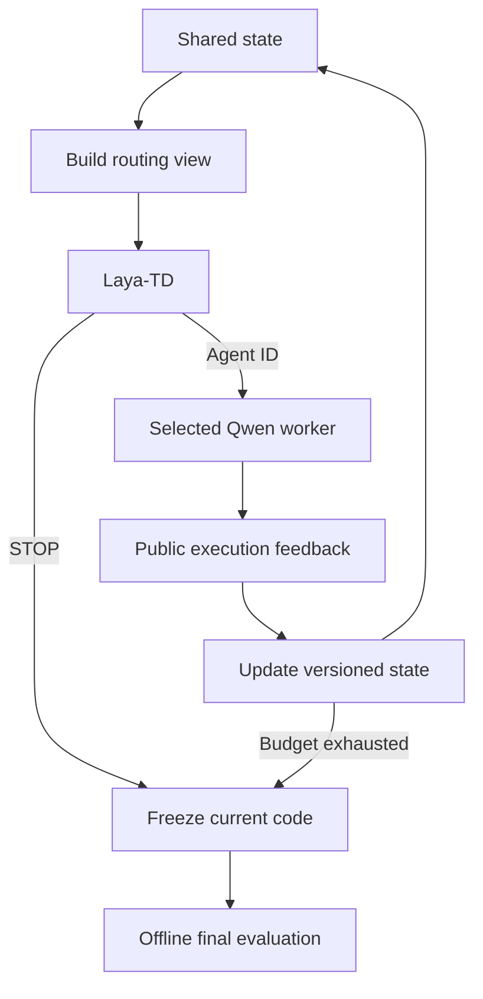

# SLM Multi-Agent System — Pilot v0 với Laya-TD

Ngày chốt: 2026-11-19. Trạng thái: **kiến trúc sơ bộ cho lần chạy thử đầu tiên**, chưa phải protocol thực nghiệm chính thức của khóa luận.

## 1. Chỉ thị triển khai cho Codex

Triển khai một hệ thống Python chạy được theo đặc tả này. Mục tiêu là chạy pilot nhỏ, đọc trajectory và xác định cần sửa kiến trúc ở đâu. Không tối ưu điểm bằng cách âm thầm thay model, prompt, test, state hoặc cơ chế dừng.

Người dùng đã xác nhận:

- Giữ vòng routing → execution → feedback → cập nhật state, lấy cảm hứng từ Jev-LiteMAS.
- Bỏ screening và LLM reviewer riêng; giữ feedback thực thi và khả năng sửa artifact.
- Router đầu tiên: `convaiinnovations/laya-typed-decisions` (Laya-TD).
- Benchmark đầu tiên: MBPP+.
- Cả ba worker dùng `Qwen/Qwen2.5-Coder-7B-Instruct`.
- Đây là pilot để xem log rồi sửa kiến trúc, chưa phải so sánh model chính thức.

Các thông số số học và cách tổ chức mã bên dưới là **mặc định kỹ thuật đề xuất**, có thể thay qua cấu hình và ghi phiên bản; không phải thông số đã được chứng minh tối ưu.

Khi khảo sát workspace KLTN ngày lập tài liệu, chỉ thấy ba PDF tham khảo, chưa có source code hoặc AGENTS.md trên đĩa. Khi triển khai hãy kiểm tra lại chỉ dẫn và cấu trúc thực tế. Nếu chưa có code, tạo thư mục con `slm_mas_pilot/`; giữ nguyên các PDF. Không hard-code đường dẫn máy người dùng.

Nếu thiếu endpoint/GPU, vẫn hoàn thành source, config mẫu, tests, mock smoke và tài liệu chạy. Chạy thật khi có model/endpoint/sandbox; nếu bị chặn, báo đúng blocker. Không gọi mock output là kết quả thực nghiệm Laya/Qwen thật.

## 2. Phạm vi và câu hỏi pilot

Pilot cần trả lời:

1. Vòng điều phối có thực sự đi qua Laya-TD và worker không?
2. Router có đủ thông tin để chọn agent có ý nghĩa không?
3. Worker có tạo/sửa code dựa trên feedback công khai không?
4. Log có phân biệt được lỗi routing, worker, state representation, harness và hạ tầng không?

Một pilot chỉ có Laya-TD không cho phép kết luận model này tốt hơn model khác, MAS tốt hơn single-agent, hoặc dynamic routing tốt hơn pipeline cố định. Task đã xem log/test cuối để sửa kiến trúc phải được ghi là development-exposed, không dùng lại như held-out test chưa bị tác động bởi thiết kế.

V0 chưa triển khai ALFWorld, ToolMisuseBench, các router còn lại, fine-tuning, reviewer, planner điều phối, workflow search, dashboard hay database. Giữ interface để bổ sung sau.

## 3. Quyết định kiến trúc

| Thành phần | Chốt v0 | Lập luận |
|---|---|---|
| Điều phối | Tập trung, chọn một agent mỗi lần | Dễ quy trách nhiệm cho từng quyết định |
| Thực thi | Tuần tự, concurrency 1 | Tránh nhiễu do lịch chạy/hợp nhất artifact |
| Router | Một câu hỏi typed choice bằng Laya-TD | Có thể thay router qua cùng interface |
| Worker pool | Analyst, Implementer, Repairer | Phân biệt phân tích, tạo và sửa code |
| Backbone | Cùng Qwen2.5-Coder-7B-Instruct | Giữ khả năng thực thi cố định |
| State | Artifact có phiên bản + feedback + lịch sử | Kiểm tra được handoff và regression |
| Feedback | Public tests và lỗi thực thi bằng code | Không đưa thêm mô hình reviewer |
| Screening/review | Không có khối riêng | Tập trung vào lựa chọn agent |
| Dừng | Router STOP hoặc giới hạn runtime | Phân biệt dừng sớm và hết ngân sách |
| Chấm cuối | Offline, sau khi đóng băng output | Không rò test cuối vào vòng sửa |
| Logging | JSON/JSONL + artifact files | Đọc lại được mà không gọi model |
| Framework | Vòng lặp Python nhỏ | Chưa cần AutoGen/LangGraph hay distributed runtime |



Chỉ lượt trả code candidate mới chạy test. Analyst không bắt buộc tạo code hay kích hoạt test. Cùng kiến trúc tương lai có thể có worker pool khác theo benchmark, nhưng pool phải cố định giữa các router trong cùng điều kiện so sánh.

## 4. Những điểm cần cân nhắc

### 4.1. Năng lực chuyển giao của Laya-TD chưa được bảo đảm

Model card mô tả checkpoint chuyên biệt cho bốn workflow, context công bố 1.024 token [S1]. Chọn worker coding là nhiệm vụ chuyển giao cần thử. Kết quả kém có thể đến từ domain shift, input bị rút gọn hoặc worker, không đủ kết luận cả lớp decision model không phù hợp MAS.

V0 không fine-tune, không đổi checkpoint tự động, không fallback sang model mạnh hơn. Xác suất cao không phải bằng chứng chọn đúng; lưu distribution để phân tích, không dùng confidence threshold để mở một nhánh xử lý khác.

### 4.2. Context ngắn có thể quyết định kết quả

Router đọc routing view ngắn; worker đọc context thực thi đầy đủ hơn. Đây là lựa chọn của v0 để tương thích Laya, không phải kết luận lượng context nào tối ưu. Khi thêm router khác, giữ cùng view policy trong phép so sánh chính.

SDK phân biệt head budget với chiều dài head thực tế [S2]. Không mặc định state luôn có đúng `1024 - 256 = 768` token. Đo renderer/tokenizer thực tế của bản SDK đã pin, bao gồm question, options và special tokens. Cấu hình context bên dưới phải qua integration check.

Lưu nội dung trước/sau rút gọn và token bị loại theo field. Không thêm LLM summarizer ngầm. Nếu mandatory content không vừa, báo input_overflow. Không âm thầm cho SDK cắt state rồi coi đó là input đầy đủ.

### 4.3. Feedback thực thi không thay thế toàn bộ reviewer

Public test pass chỉ chứng minh các ví dụ đã chạy. Router vẫn được chọn phân tích hoặc sửa tiếp. Traceback chỉ là dấu hiệu lỗi, không bảo đảm worker biết cách sửa. Giữ nguyên bằng chứng; runtime không tự viết hướng sửa có suy luận.

Không hard-code `test fail → Repairer` hoặc `test pass → STOP`. Các luật đó sẽ quyết định chiến lược thay router. Chỉ dùng ràng buộc hợp lệ như chưa có code thì chưa có artifact để Repairer sửa.

### 4.4. Phân vai có thể chưa tạo khác biệt năng lực thực tế

Cùng backbone và prompt khác là chuyên môn theo vai trò, chưa chứng minh mỗi role làm tốt một loại việc. Implementer và Repairer có thể dư thừa. Pilot cần nhìn đầu ra, lựa chọn và thay đổi artifact để quyết định giữ/gộp role.

Analyst được phân tích thuật toán, không được chọn agent tiếp theo. Một dispatch là một generation; worker không tự chạy vòng solve–test–repair. Nếu worker tự điều phối nội bộ nhiều vòng, vai trò router bên ngoài sẽ bị che khuất.

### 4.5. STOP, budget và chất lượng là các biến khác nhau

STOP khi code sai là hành vi cần quan sát. Hết budget không tự động có nghĩa code sai: vẫn chấm candidate cuối. Không tự chọn code tốt nhất bằng hidden tests, không thêm final LLM sửa output. Giữ candidate mới nhất kể cả regression, để xem chất lượng thay đổi ra sao.

### 4.6. Không suy diễn nguyên nhân từ final failure

Router chọn Repairer rồi worker sửa thất bại chưa chứng minh chọn sai. Log các dấu hiệu quan sát được: lặp role, code hash không đổi, public fail kéo dài, STOP khi public fail, output parse error, context overflow. Nhãn nguyên nhân do người đọc suy luận phải ghi là hypothesis; không gọi là routing accuracy khi chưa có ground-truth action.

### 4.7. Chi phí/latency phụ thuộc triển khai

Laya chạy CPU và Qwen qua endpoint là cấu hình khởi đầu, không phải phép so sánh hardware đồng nhất. Tách cold load, warmup, routing, worker request, public tests và final evaluation. Local inference không có nghĩa chi phí bằng 0; monetary cost để null nếu chưa định giá được.

### 4.8. Chỉnh kiến trúc phải tạo run mới

Không chỉnh prompt giữa batch rồi gộp số liệu. Mỗi thay đổi có architecture_version, config_hash, prompt_hashes mới. Giữ task manifest khi kiểm tra tác động một thay đổi. Các task đã xem để chỉnh hệ thống phải đánh dấu development-exposed.

## 5. State và interfaces

Các trường dưới đây là contract do hệ thống định nghĩa, không phải schema giả định của SDK ngoài. Dùng dataclass/Pydantic hoặc cách tương đương.

- `PublicTask`: task_id, task_text, entry_point, public_examples, public_assertions, source_revision, public_payload_hash. Không có reference solution/base_input/plus_input của evaluator.
- `Artifact`: artifact_id, kind (analysis/code), content, content_hash, producer_role, worker_step, parent_id, based_on_code_id.
- `PublicFeedback`: code_artifact_id, status, passed, failed, total, failure_category, concise_error, stdout_ref, stderr_ref, duration_ms, truncation_metadata.
- `WorkerAttempt`: role, input_snapshot_ref, raw_response_ref, parse_status, artifact_id hoặc null, finish_reason, usage, timings, error.
- `BudgetState`: worker_dispatches_used/limit, router_decisions_used, elapsed_ms, deadline_ms.
- `WorkflowState`: PublicTask, current_code_id hoặc null, latest_analysis_id hoặc null, latest_feedback hoặc null, last_worker_attempt, recent_events, BudgetState. Full artifacts nằm trong artifact store.
- `RoutingRequest`: routing_view, ordered_legal_actions, question_text, option_descriptions, view_policy_version, source_state_hash, input_hash, tokenization_metadata.
- `RoutingDecision`: action, model_choice_raw, probabilities hoặc null, raw_response_ref, elapsed_ms, validation_status.
- `EpisodeResult`: task_id, termination_reason, final_code_id/hash hoặc null, workflow_status, evaluation_status, base_pass, plus_pass, metrics.

Current code là candidate mới nhất trích xuất thành công từ Implementer/Repairer, kể cả syntax-invalid. Không tự quay lại code cũ khi test fail. Parse failure giữ code cũ, ghi riêng last attempt error. Mọi analysis có based_on_code_id để không xem ghi chú cũ là nhận xét đã xác minh của code mới. Feedback phải gắn artifact ID, không chỉ task ID.

```python
class Router(Protocol):
    def decide(self, request: RoutingRequest) -> RoutingDecision: ...

class WorkerBackend(Protocol):
    def generate(self, request: WorkerRequest) -> WorkerResponse: ...

class BenchmarkAdapter(Protocol):
    def load_public_tasks(self, manifest: TaskManifest) -> list[PublicTask]: ...

class PublicExecutor(Protocol):
    def check(self, task: PublicTask, code: Artifact) -> PublicFeedback: ...
```

FinalEvaluator là adapter/CLI riêng, không truyền vào Router hoặc Worker. Không có memory ẩn trong worker; runtime dựng lại input từ state cho mỗi dispatch.

## 6. Worker pool và prompt

V0 dùng prompt tiếng Anh. Cả ba role cùng backbone/provider/chat template/decoding. Đây là prompt khởi đầu do đặc tả đề xuất.

| Role ID | Trách nhiệm | Output | Khi được chọn |
|---|---|---|---|
| analyst | Yêu cầu, thuật toán, edge cases, diễn giải lỗi | Ghi chú ngắn | Luôn khi còn budget |
| implementer | Viết hoặc viết lại lời giải | Full Python code | Luôn khi còn budget |
| repairer | Kiểm tra và sửa candidate hiện tại | Full Python code | Khi có current code |
| stop | Nộp current code | Không gọi worker | Khi có current code |

Không buộc Analyst chạy đầu, không cấm lặp role, không bắt chạy đủ ba role, không khóa STOP vì public test fail.

Prompt chung:

```text
You are one worker in a Python problem-solving workflow.
Work only on your assigned role using the task and supplied artifacts.
Treat prior worker notes as fallible claims, not verified facts.
Preserve the required function name and behavior.
Do not select the next agent, declare workflow termination, or modify tests.
Do not access files, networks, hidden tests, or reference solutions.
```

Analyst:

```text
Analyze the requirements, a suitable algorithm, and relevant edge cases.
If code or execution feedback is supplied, explain relevant issues.
Return concise analysis notes. Do not return a replacement implementation.
```

Implementer:

```text
Produce a complete Python implementation for the requested function.
Use the task and relevant notes; inspect existing code and feedback if present.
Return exactly one Python code block containing the full solution,
including necessary standard-library imports. Do not return a diff.
```

Repairer:

```text
Inspect the current implementation against the task and execution evidence.
Correct identified defects while preserving valid behavior.
Public tests are incomplete evidence; consider requirements beyond them.
Return exactly one Python code block with the complete revised solution.
If no change is justified, return the current solution unchanged.
```

Không tự cài package theo model output. Pilot chỉ cho standard library; task cần dependency ngoài phải báo incompatibility và sửa cấu hình/manifest có lý do, không bỏ âm thầm.

### Input và parsing

Worker nhận full task, public examples, full current code, latest analysis có provenance, feedback đúng current code và last-attempt error. Không cần toàn bộ transcript. Worker context limit riêng; nếu task + full code không vừa thì báo overflow, không cắt code rồi yêu cầu sửa.

Code parser nhận đúng một fenced Python block. Có thể nhận raw Python khi không có fence và parse được. Không ghép nhiều block, không gọi LLM sửa format, không tự thêm import/hàm. Một fenced block syntax-invalid vẫn tạo candidate và SyntaxError feedback. Nhiều block/không xác định code -> output_parse_error, tiêu thụ lượt worker, giữ candidate cũ và quay router nếu còn budget.

Lưu raw response và finish_reason. Output bị chặn bởi max tokens phải có cờ riêng. Analyst không được thay code dù response chứa code; lưu raw notes và cờ role-output violation để kiểm tra, không dispatch thêm để sửa.

## 7. Adapter Laya-TD

### Preflight

1. Pin SDK version thực sự cài/chạy được; không bịa số version.
2. Resolve đúng checkpoint thành immutable revision; ghi revision/hash. Nếu SDK không hỗ trợ revision trực tiếp, tải snapshot bất biến và load local theo API đã kiểm tra.
3. Kiểm tra input/output schema và token renderer của version cài; lưu một real-response fixture không chứa secrets.
4. Load một lần, giữ resident. Không auto-route sang Laya English/multilingual/Vega hoặc teacher fallback.
5. Device mặc định CPU, CUDA configurable. Ghi dtype, quantization, effective device.
6. Smoke một choice request ngắn, xác minh option hợp lệ và input không bị cắt.
7. Cold load/warmup tách khỏi thời gian quyết định thông thường.

API hình dạng tham khảo từ tài liệu [S1,S2]; phải kiểm tra với version pin, không xem là code đã test:

```python
import laya
agent = laya.load("convaiinnovations/laya-typed-decisions")
questions = {
    "next_agent": {
        "type": "choice",
        "instructions": "Choose the next action to solve the task using the current evidence and remaining budget.",
        "criteria": {
            "analyst": "Analyze requirements, algorithm, or unresolved issues.",
            "implementer": "Create or rewrite the Python solution.",
            "repairer": "Inspect and repair the current Python solution.",
            "stop": "Submit the current solution without further work."
        }
    }
}
result = agent.predict(state, questions)
```

Lọc criteria theo legal actions **trước** inference. Đầu task chỉ gửi analyst/implementer. Thứ tự v0: analyst, implementer, repairer, stop sau lọc; lưu ở mỗi step. Chưa tự chạy hoán vị options trong workflow.

Nếu probabilities có mặt: kiểm tra đúng keys, finite, nonnegative, sum trong tolerance đã ghi; chọn argmax, tie-break theo thứ tự đã log. Không softmax lại probabilities. Lưu raw choice của SDK và effective action. Nếu SDK chỉ có choice, nhận choice hợp lệ, probabilities=null; không bịa distribution.

Response sai hoặc action ngoài tập -> router_output_error và dừng episode system error; không fallback heuristic. Không yêu cầu rationale, không sinh lời giải thích giả cho quyết định. Mọi probability/confidence chỉ là dữ liệu quan sát, không phải xác suất thành công đã được kiểm định trên MAS.

## 8. Routing view và truncation

Full state và routing view được lưu riêng. Router không có đường khác đọc full state. Field khách quan do runtime tính; worker tự nhận hoàn tất không được chuyển thành task_success.

View gồm task, entry point, budget, current-code status, last-attempt error, public feedback summary, code excerpt, analysis excerpt và tối đa ba event gần nhất.

Thuật toán đề xuất `routing_view_v0`:

1. Giữ nguyên task text, entry point, budget, code existence, public counts/status và last-attempt error category. Giữ question/options không bị cắt.
2. Concise error chỉ gồm exception type/message và traceback liên quan candidate, tối đa 96 tokenizer tokens; đánh dấu cắt. Khi pass chỉ giữ counts.
3. Tính budget còn lại bằng renderer/tokenizer thật. Mandatory không vừa -> input_overflow, không tự bỏ task hay cắt đề.
4. Chia phần còn lại: code 65%, analysis 25%, recent events 10%. Field rỗng trả budget về code rồi analysis. Đây là tỷ lệ khởi đầu để quan sát.
5. Code quá dài: lấy prefix/suffix tỷ lệ 2:1 tại ranh giới dòng, thêm marker CODE_EXCERPT_INCOMPLETE. Full code gửi worker/chạy test vẫn nguyên vẹn.
6. Analysis lấy prefix theo dòng/câu với marker. Event chỉ metadata ngắn, ưu tiên mới nhất rồi render theo thứ tự thời gian.
7. Render/tokenize lại, giảm optional excerpts tới khi vừa. Mandatory không vừa thì báo lỗi rõ.
8. Xác minh SDK không cắt thêm state/options. Log head_len, state_len, total_len, dropped tokens từng field, option_truncated. SDK truncation ngoài kiểm soát phải chặn episode để sửa adapter trước batch thật.

Không dùng số ký tự thay token budget, không thêm embeddings/LLM summary/semantic retrieval ở v0. Nếu phải instrument SDK internals để lấy rendered token IDs, pin version, bao instrumentation trong adapter và integration-test nó. Không giả định tokenizer của worker dùng được cho router.

## 9. MBPP+ và ranh giới dữ liệu

### Dataset và manifest

Mục tiêu MBPP+ v0.2.0, quy mô công bố 378 task [S3]. **Dataset version khác EvalPlus package version.** Pin package tương thích sau integration check; ghi dataset hash và IDs thực tế. Nếu count/version khác dự kiến, báo khác biệt ở prepare-data; không cắt về 378 để giả khớp.

Source loader hiện có API cho MBPP+ và sanitized MBPP [S4]; kiểm tra chữ ký bản cài thay vì đoán.

Mặc định: sort ID theo phần số, dùng RNG cục bộ seed 42 chọn 20 task không hoàn lại; lưu manifest. Ba task đầu là real smoke subset. Không chọn lại task vì điểm thấp. Nếu task không chuẩn bị được, ghi prep error và giữ ID trong audit, không thay ngầm bằng task khác.

Lưu development_exposed_ids.json cho task đã xem output/log/test cuối hoặc dùng chỉnh kiến trúc. Seed không thay thế danh sách IDs/snapshot/hash. Không tuyên bố đã loại được pretraining contamination chỉ nhờ tách development.

### Public feedback policy: mbpp_public_original_examples_v0

Chỉ dùng đề và ví dụ/assertions công khai của bài MBPP tương ứng. Map sanitized MBPP sang MBPP+ theo ID, kiểm tra entry point và nội dung. Không lấy expected output từ reference solution.

Prepare-data xuất hai vùng riêng:

- Public export: task text, entry point, public examples/assertions và metadata nguồn. Online orchestration chỉ đọc vùng này.
- Evaluator data: reference, base/plus inputs, oracle và metadata chấm. Offline evaluator mới được đọc.

Mapping không khớp/thiếu public assertions -> dataset_mapping_error. Không lấy base_input/plus_input làm feedback thay thế. Field tên base không tự động có nghĩa agent được xem. Public examples có thể trùng một số base tests; báo protocol có public feedback, không coi điểm này tương đương one-shot/no-feedback leaderboard.

### Chấm cuối

Đóng băng một final candidate/episode và hash trước evaluation. Xuất đúng schema full solution/completion mà EvalPlus version pin yêu cầu; không đoán. Dùng evaluator gốc cho base/extended tests. Ghi base_pass, plus_pass theo đúng ý nghĩa output; strict_success yêu cầu qua cả hai. Nếu evaluator trả combined result, tránh gán nhãn/đếm hai lần.

Không có code -> no_candidate và strict_success=false. Evaluator hỏng -> evaluation_error, không giả thành model incorrect/pass. Test cuối không đi vào online state, worker prompt, router prompt hay resume của episode đó. Không chọn code cũ tốt hơn bằng evaluator.

## 10. Runtime và ngân sách

Mặc định 6 worker dispatches/episode; một dispatch = một generation. Tắt automatic retries của provider SDK ở v0 để không ẩn số call/chi phí. HTTP/transport error dừng system_error, không gán thành lỗi logic worker. Nếu backend có retry không tắt được phải instrument/count rõ và ghi deviation trước run.

Router quyết định trước worker đầu. Sau dispatch thứ 6, dừng budget và freeze, không gọi STOP bắt buộc. Tối đa 6 routing decisions tương ứng tối đa 6 dispatches; STOP có thể kết thúc sớm.

Decoding đề xuất: temperature 0, top_p 1, max_new_tokens 1024 cho cả ba role. Worker context tổng 8192 tokens gồm dự trữ output, xác minh endpoint. Greedy không bảo đảm bitwise determinism qua mọi backend. Lưu requested/effective settings.

Timeout đề xuất: worker request 120s, public suite execution 10s, episode 900s, router inference 30s. Dùng remaining deadline trước từng bước; cần supervisor/process riêng nếu phải cưỡng chế timeout CPU/model/code. Ghi configured/effective timeout. Chưa coi các giới hạn này là constraint khoa học tối ưu.

```text
preflight(config, checkpoint, endpoint, sandbox, public_data)
initialize empty state
while worker_dispatches_used < 6:
    if deadline exceeded: finalize(wallclock_budget_exhausted); break
    legal = analyst + implementer
    if current_code exists: add repairer + stop
    build/validate routing request; persist before inference
    call router; persist raw response and action
    if router failed: finalize(system_error); break
    if action == stop: finalize(router_stop); break
    build worker request from permitted state
    increment worker_dispatches before provider call
    persist request; call worker once; persist response
    if infrastructure error: finalize(system_error); break
    if analyst: store notes, leave code/feedback intact
    else:
        extract code
        if parse failure: record last-attempt error, keep old candidate
        else:
            store new code; make it current, even if syntax-invalid
            invalidate old feedback; run syntax/public checks
            attach feedback to this exact code artifact
    persist updated state
else:
    finalize(worker_budget_exhausted)
freeze current code if any; persist episode result
# separate process: offline evaluation and report
```

Candidate SyntaxError/AssertionError/runtime exception/execution timeout là feedback. Container startup failure hoặc executor crash là system error. Phân biệt timeout chạy candidate và timeout hạ tầng.

System-error episode có thể lưu candidate trước đó để chẩn đoán nhưng phải báo riêng, không trộn vào nhóm hoàn tất bình thường. V0 không cần crash-resume phức tạp; chạy lại thành run mới. Không resume từ state đã nhìn test cuối.

## 11. Thực thi code được sinh ra

Không exec candidate trong process orchestrator. Dùng container Linux/sandbox tương đương: no network, non-root, không secrets, resource limits, chỉ mount public payload/candidate read-only và scratch nhỏ. Không mount workspace/model cache/evaluator cache vào public executor.

Mặc định Docker đề xuất: 1 CPU, 512 MiB RAM, PID 64, read-only filesystem, tmpfs giới hạn, hard timeout và supervisor có thể kill cả process tree. Ghi image digest/effective limits. Bound stdout/stderr và lưu cờ bị cắt. Chỉ harness đáng tin quyết định pass/fail, không đọc dòng 'all tests passed' do candidate in ra. Worker không được sửa test file.

Docker chưa có: mock vẫn chạy, real code execution báo blocked; không tự fallback chạy trên host. Offline EvalPlus cũng chạy cô lập nhưng có quyền đọc evaluator data. README nêu giới hạn triển khai; không tuyên bố container là sandbox tuyệt đối.

## 12. Logging và report

Mỗi trajectory phải dựng lại được từ log mà không gọi model. Không chỉ lưu điểm cuối.

```text
runs/<run_id>/
  run_manifest.json
  config.resolved.yaml
  prompts/
  tasks.manifest.json
  episodes/<safe_task_id>/
    events.jsonl
    snapshots/
    router/
    worker/
    artifacts/
    public_checks/
    final.py
    episode_result.json
  evaluation/
  summary.json
  episode_metrics.csv
  report.md
```

Event envelope: schema_version, run_id, task_id, event_seq, event_type, timestamp_utc, monotonic_elapsed_ms, worker_step, decision_index, state_hash, payload/ref. Flush sau sự kiện quan trọng. Exact payload lớn lưu file riêng, có hash/ref.

Event tối thiểu: run_started, model_loaded, episode_started, routing_view_built, router_request/response/decision, worker_request/response/parse_error, artifact_created, public_check_started/finished, state_updated, episode_finalized, system_error, evaluation_finished.

Router log: exact view/question/options/order; source-state hash; rendered input hash; token counts/head counts/dropped tokens; model/revision/SDK/device; raw response; probabilities nếu có; top1/top2/margin nếu tính được; raw SDK choice và effective action; latency tổng, encode/inference/decode nếu đo được.

Worker log: exact role/messages, model/backend/quantization nếu biết, seed requested/effective, decoding, raw completion/finish_reason, usage và nguồn đo, latency, parser result, artifact hash và diff metadata.

Test log: code ID/hash, public suite hash, counts, failure category, traceback/output có giới hạn, execution timeout/resource limits. Hidden evaluator output ở evaluation/ riêng, online context builder không đọc.

Không lưu API keys, Authorization headers, access tokens hoặc toàn bộ environment. Model payload benchmark được lưu đầy đủ nhưng secrets không thuộc payload.

Report tự động, không cần LLM judge:

- Bảng episode: ID, action sequence, termination, calls, public status, strict final outcome, latency, truncation, errors.
- Role distribution, repeated role, unchanged code hash, public fail-to-pass, pass-to-fail regression, STOP khi public fail, budget exhaustion, format/router/infra errors, context overflow.
- Chuyển tiếp public test tính giữa code versions, không tính Analyst như code regression.
- Từng failure có exact log refs để kiểm tra. Giải thích nguyên nhân nhân công phải là hypothesis.
- Không tính routing accuracy khi chưa có ground-truth next-agent labels.

## 13. Chỉ số và mẫu số

- strict_success_over_selected: successful / tất cả selected tasks, kèm missing/blocked/system error counts. Đây là thống kê vận hành bảo thủ, không quy mọi missing thành model failure.
- strict_success_over_valid_episodes: successful / episode không lỗi hạ tầng và outcome xác định; no_candidate/output failure vẫn là thất bại, không loại để làm đẹp số liệu. Công bố denominator và exclusion reasons.
- evaluation_coverage: số task có outcome xác định / selected tasks; tách no_candidate và evaluator error.
- Public success, base_pass, plus_pass riêng; không thay strict bằng public.
- Worker tokens input/output/total và nguồn provider/local estimate; thiếu thì null, không 0.
- Router input tokens/decisions/latency; không sinh text không đồng nghĩa zero compute.
- Workflow latency từ episode start đến freeze, không gồm model load/warmup/offline evaluator. Báo riêng cold setup, evaluation và total run time.
- Monetary cost null nếu thiếu pricing/resource rates. Không dùng một giá token chung cho Laya local và Qwen endpoint.

Pilot 20 task, một lượt/task chỉ có thống kê mô tả; không claim xếp hạng hay significance. Run lặp tương lai phải giữ task/seed granularity, không coi các lượt cùng task là task độc lập.

## 14. Tổ chức mã và cấu hình

Python 3.11 là môi trường khởi đầu; nếu dependency pin yêu cầu khác, ghi rõ và dùng môi trường riêng. Tách extras để mock không cần tải model.

```text
slm_mas_pilot/
  pyproject.toml
  README.md
  .env.example
  configs/pilot_laya_mbpp.yaml
  prompts/{common,analyst,implementer,repairer,router}.txt
  src/slm_mas/
    cli.py
    schemas.py
    runtime.py
    state.py
    context.py
    logging.py
    reporting.py
    routers/{base,laya_td,mock}.py
    workers/{base,openai_compatible,mock}.py
    benchmarks/mbpp.py
    execution/{public_runner,sandbox}.py
    evaluation/evalplus_adapter.py
  tests/
  docker/
```

OpenAI-compatible chỉ là giao thức endpoint, không có nghĩa dùng model OpenAI. Hosting Qwen chưa được xác định; cung cấp endpoint adapter và hướng dẫn, không giả định laptop đủ GPU hoặc tự đổi model. Kiểm tra served model ID, chat template, quantization và usage mà provider hỗ trợ.

```yaml
architecture_version: pilot_v0
run_mode: real
seed: 42
concurrency: 1
router:
  kind: laya_td
  model_id: convaiinnovations/laya-typed-decisions
  revision: null  # resolve immutable revision before real run
  device: cpu
  max_len: 1024
  head_max_len: 256
  decision_policy: argmax
  auto_checkpoint_selection: false
  fallback: none
  view_policy: routing_view_v0
workers:
  backend: openai_compatible
  requested_model: Qwen/Qwen2.5-Coder-7B-Instruct
  served_model: null  # explicitly map to endpoint model ID
  base_url_env: WORKER_BASE_URL
  api_key_env: WORKER_API_KEY
  temperature: 0
  top_p: 1
  max_new_tokens: 1024
  context_limit: 8192
  request_timeout_seconds: 120
  automatic_retries: 0
benchmark:
  name: mbpp_plus
  dataset_version: v0.2.0
  sample_size: 20
  sample_seed: 42
  manifest: data/manifests/pilot_20.json
  public_feedback_policy: mbpp_public_original_examples_v0
budget:
  max_worker_dispatches: 6
  episode_timeout_seconds: 900
execution:
  backend: docker
  image_digest: null  # build/resolve and pin
  cpus: 1
  memory_mb: 512
  pids_limit: 64
  public_suite_timeout_seconds: 10
  network: none
evaluation:
  mode: offline_only
logging:
  save_exact_model_payloads: true
  save_full_artifacts: true
  save_state_snapshots: true
  redact_secrets: true
```

Null setup values phải resolve trước real run, không tự chọn thay thế. Ghi resolved config cùng immutable model/dataset/image IDs.

## 15. CLI cần triển khai

Các lệnh dưới là thiết kế CLI của ứng dụng này, **không phải CLI có sẵn đã được kiểm chứng**:

```bash
python -m slm_mas.cli doctor --config configs/pilot_laya_mbpp.yaml
python -m slm_mas.cli prepare-data --config configs/pilot_laya_mbpp.yaml
python -m slm_mas.cli smoke --mock
python -m slm_mas.cli smoke --config configs/pilot_laya_mbpp.yaml --limit 3
python -m slm_mas.cli run --config configs/pilot_laya_mbpp.yaml
python -m slm_mas.cli evaluate --run-dir runs/<run_id>
python -m slm_mas.cli report --run-dir runs/<run_id>
python -m slm_mas.cli inspect --run-dir runs/<run_id> --task-id <task_id>
```

Doctor kiểm tra dependencies, checkpoint, rendering, endpoint/model, sandbox/config, không dump secrets. Prepare-data tạo export/manifest; evaluator data tách khỏi online path. Mock dùng synthetic fixture, không tải model/dataset hoặc gọi mạng. Inspect/report chỉ đọc, không gọi lại model. Mọi smoke/run có run_id riêng, không gộp hai execution cùng task thành một episode.

## 16. Tests và nghiệm thu

Chỉ viết test cho invariants ảnh hưởng tính đúng thực nghiệm, không cần test vụn lặp lại implementation.

1. Legal actions trước/sau có code; public pass/fail không khóa lựa chọn.
2. Scripted trajectory implementer → public fail → repairer → stop, feedback đúng artifact và final là code mới nhất.
3. SyntaxError trở thành feedback; parse error giữ code cũ và ghi last-attempt error.
4. Analyst không xóa code/feedback; analysis giữ provenance.
5. Budget đúng 6 dispatches, không call thứ 7/final LLM ngầm.
6. Hết budget không code -> no_candidate, không crash.
7. Router invalid response -> error, không fallback; mock fixture không chạy trong real mode.
8. Sentinel reference/hidden fields không có trong bất kỳ model input nào; online chỉ load public export.
9. Truncation giữ mandatory content và options, lưu markers/rendered length; overflow báo rõ.
10. Candidate timeout/exception phân biệt infrastructure failure; public executor không có hidden data.
11. Frozen hash không đổi sau evaluator; report không sửa online state.
12. Usage thiếu là null; output failures không bị loại khỏi denominator hợp lệ.

Bằng chứng nghiệm thu:

- Tests mock pass và một mock run/report hoàn chỉnh.
- Real Laya call kiểm tra schema/tokenization nếu model/dependency có sẵn.
- Real 3-task smoke có exact payloads, artifact versions, terminal reasons; đúng Qwen endpoint đã cấu hình.
- Pilot 20 task có manifest, mỗi task có outcome hoặc lý do blocked/error; không bỏ task khỏi report.
- Có thể inspect episode mà không gọi API.
- IMPLEMENTATION_NOTES.md ghi versions, revisions, public-test mapping, commands thực sự đã chạy, verification và blockers.

Thiếu endpoint/sandbox/model thì hoàn tất code/mock được, nhưng real pilot phải ghi not_run/blocked. Không bịa kết quả để đáp ứng checklist.

## 17. Thứ tự triển khai

1. Schemas, artifacts/events, vòng lặp scripted mock.
2. Public export MBPP/manifest và kiểm thử ranh giới evaluator.
3. Sandbox/public runner với fixture pass/fail/SyntaxError/timeout.
4. Worker endpoint adapter và một generation thật nếu sẵn sàng.
5. Laya adapter, exact rendering/token budgets và smoke thật.
6. Ghép real smoke 3 task; sửa lỗi tích hợp, không chọn lại task theo score.
7. Offline evaluation/report rồi pilot 20 task.

Không thêm reviewer hoặc model khác để che lỗi. Mỗi mốc phải có output reviewable. Khi chưa đủ hạ tầng, không dừng ở kế hoạch nếu còn source/tests/mock có thể hoàn thành.

## 18. Cách đọc log để điều chỉnh v1

| Dấu hiệu | Kiểm tra trước | Thử nghiệm tiếp theo ở run mới |
|---|---|---|
| Chỉ chọn một role | Option truncation, mô tả, label/order bias | Chỉnh wording/đảo order trên saved states |
| STOP rất sớm | Router có thấy code/feedback, public tests quá yếu | Sửa view hoặc STOP description, không ép repair ngầm |
| Analyst lặp | Notes có thêm thông tin, budget có rõ | Thu hẹp prompt hoặc ablate role |
| Repair không tiến triển | Feedback có đúng version, worker thấy full code | Sửa handoff trước khi đổ lỗi router |
| Public pass nhưng final fail | Edge cases chưa được ví dụ phủ | Phân tích hạn chế feedback, không đưa hidden tests vào loop |
| Sửa từ pass thành fail | Code/feedback trước và sau | Cân nhắc rollback/stopping ở v1 |
| Confidence cao nhưng kết quả kém | Exact rendered input, domain shift | Phân tích riêng; không mặc định calibrated |
| Task dài mới thất bại | Code excerpt có mất thông tin không | Thay representation/long-context configuration |
| Mọi task thất bại | Worker sanity, mapping, sandbox/endpoint | Sửa pipeline trước khi kết luận về model |
| Mọi task quá dễ | Worker xong ngay lần đầu | Mở rộng sample, xem task cần nhiều lượt |

Không gọi một routing action là tối ưu nếu chưa so sánh continuation tương ứng. Counterfactual replay có thể thêm sau, không tự chạy nhiều model ở v0.

Sau v0: ưu tiên fixed-workflow/random-valid baselines rẻ, rồi thêm Jev/Clef/generative routers trên cùng worker/task/view policy. Single-worker iterative baseline giúp kiểm tra giá trị phân vai, chưa bắt buộc trong lần thử đầu.

## 19. Nguồn và phạm vi bằng chứng

Nguồn kỹ thuật kiểm tra ngày 2026-11-19. Phần lớn tài liệu này là quyết định thiết kế cho pilot, không phải chi tiết được sao từ paper/SDK.

- [S1] Laya-TD model card: https://huggingface.co/convaiinnovations/laya-typed-decisions — checkpoint, chuyên biệt, context công bố, API load tham khảo. Không dùng benchmark score làm dự đoán điểm MAS.
- [S2] Laya SDK: https://github.com/NandhaKishorM/laya — typed choice, renderer và token budgets; pin version khi triển khai.
- [S3] EvalPlus: https://github.com/evalplus/evalplus — MBPP+ version/size và evaluator chính thức.
- [S4] MBPP loader: https://github.com/evalplus/evalplus/blob/master/evalplus/data/mbpp.py — loader sanitized MBPP và MBPP+, cần kiểm tra API bản cài.
- [S5] Qwen worker: https://huggingface.co/Qwen/Qwen2.5-Coder-7B-Instruct — checkpoint đã chọn.
- [S6] Jev-LiteMAS: https://arxiv.org/abs/2610.21411 — cảm hứng next-expert selection/handoff; PDF đã thảo luận trong dự án. Pilot bỏ screening/reviewer nên không thừa hưởng trực tiếp kết quả hệ gốc.

Phân biệt thông tin nhà phát triển công bố, hành vi đã xác minh bằng integration test và kết quả pilot thật. Model card/README không chứng minh model sẽ điều phối tốt trong hệ này.

## 20. Prompt bàn giao

> Đọc toàn bộ SLM_MAS_PILOT_V0_LAYA_TD.md và chỉ dẫn workspace. Triển khai pilot v0: MBPP+, router Laya-TD, ba worker Qwen2.5-Coder-7B-Instruct, không screening/LLM reviewer, có public execution feedback và offline evaluation. Bắt đầu bằng schemas, logging và mock end-to-end, sau đó tích hợp dữ liệu, sandbox, endpoint worker và Laya thật. Lưu exact input/output và artifact versions để đọc trajectory. Không tự thay model hoặc mở rộng phạm vi. Nếu thiếu endpoint/model/sandbox, hoàn thành phần code/mock làm được, ghi blocker, không tuyên bố đã chạy thật. Báo các commands đã chạy, kết quả verification và run/report paths.
